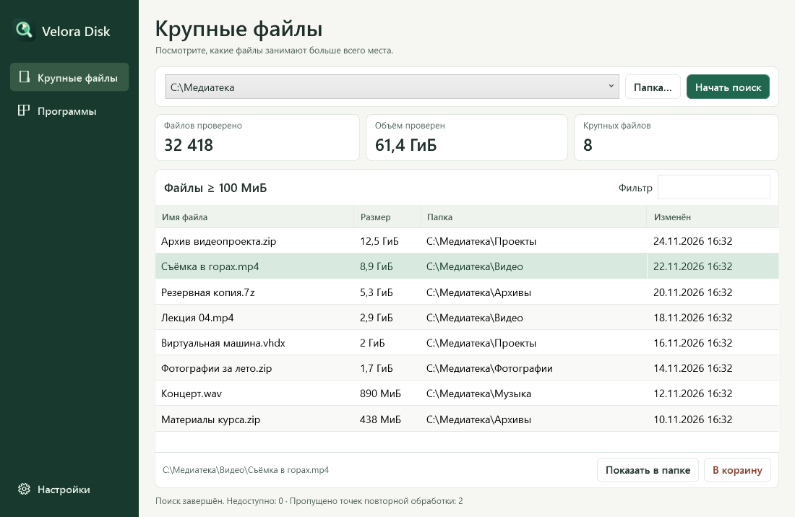

# Velora Disk


**Windows 10 / 11 · Русский / English**

[Скачать установщик Windows / Download installer](https://github.com/tvoibambuk/Kocmoc-Music-/raw/refs/heads/velora-disk/downloads/VeloraDisk-Setup.msi) · [Версия без установки / Portable EXE](https://github.com/tvoibambuk/Kocmoc-Music-/raw/refs/heads/velora-disk/downloads/VeloraDisk.exe) · [SHA-256](downloads/SHA256SUMS.txt)



## Русский

Скачайте MSI, дважды щёлкните по нему и нажмите **Install**. Откройте **Velora Disk** из меню «Пуск». Можно также запустить портативный EXE. Для работы нужен .NET Framework 4.8. Сборка без цифровой подписи издателя.

* В разделе **Крупные файлы** выберите весь компьютер, диск или папку и нажмите **Начать поиск**. Исходный порог — 100 МиБ. Можно остановить поиск и посмотреть уже найденные файлы. Нажмите на заголовок столбца для сортировки.
* Чтобы проверить файл, выберите его и откройте расположение в Проводнике. Доступные для удаления файлы можно по одному перемещать в корзину после подтверждения. Восстановление доступно через корзину Windows. Для освобождения места понадобится отдельно очистить корзину.
* В разделе **Программы** можно искать по названию и издателю, а также сортировать по размеру. Когда Windows не сообщает размер, приложение помечает его как неизвестный. После подтверждения откроется штатный деинсталлятор или параметры Windows. По завершении нажмите **Обновить**.
* В **Настройках** можно сменить язык, порог размера и максимальное число результатов. Настройки сохраняются для текущего пользователя.

При проверке всего компьютера программа обходит доступные локальные фиксированные диски. Счётчики показывают логические размеры файлов. Среди результатов могут быть нужные файлы. Защищённые расположения доступны для просмотра, действие с корзиной ограничено. Недоступные папки и точки повторной обработки, включая ссылки и некоторые облачные файлы, учитываются отдельно. Всё сканирование выполняется на ПК.

## English

Open the MSI and select **Install**, then launch **Velora Disk** from Start. Alternatively, run the portable EXE. Requires Windows 10/11 and .NET Framework 4.8. The binaries are unsigned.

* **Large files** scans all fixed drives, one drive or a folder. The default threshold is 100 MiB. Stop a scan to inspect partial results. Select a column heading to sort, then use a row to reveal its location or move an eligible file to the Recycle Bin.
* **Applications** lists desktop uninstall registrations and launchable packaged apps. Search by name or publisher, or sort by reported size. Confirm to open the registered uninstaller or Windows Settings. Refresh after the uninstall finishes.
* **Settings** saves your language, minimum file size and result limit. Reparse points and unreadable locations are counted separately. The scanner reads file metadata locally. File sizes are logical sizes and hard links can refer to the same storage.

## Build and test

Use Windows PowerShell 5.1 on Windows with .NET Framework 4.8. The script uses the Windows C# compiler. Packaging uses the pinned [WiX 3.14.1 toolset](https://github.com/wixtoolset/wix3/releases/tag/wix3141rtm). The script downloads and checks its archive on the first MSI build, or accepts an existing toolset directory via `-WixDir`.

```powershell
.\scripts\Build.ps1
.\scripts\Build.ps1 -PortableOnly
.\tests\Test-Scanner.ps1
.\tests\Test-UI.ps1
```

Build output is in `dist`. The optional `-ExerciseRecycle` scanner test sends a uniquely named temporary fixture to the Windows Recycle Bin. The regular scanner tests use a generated folder.
